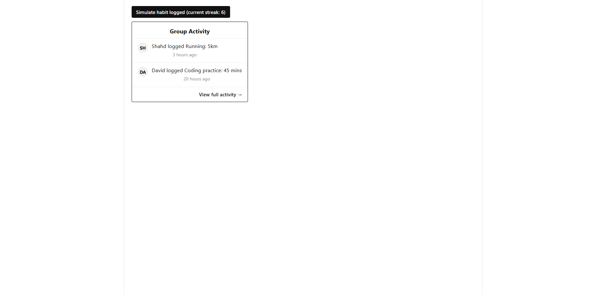
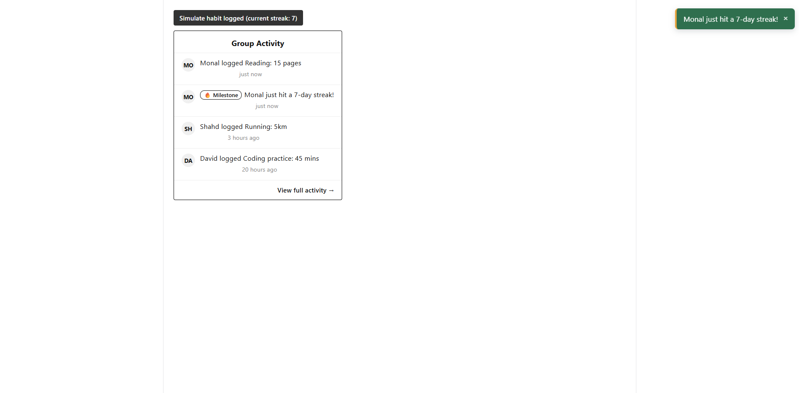

# Informal GUI Test Log - Activity Feed & Milestone Toast (EH-59, EH-60)

This document lets anyone repeat these tests themselves and confirm they get
the same result. Both components were tested using a temporary local preview
(Vite + React), with mock data matching the real shape produced by
`buildGroupFeed` (EH-34). The feed is styled to match Figure 23 in our
group design document (Micro-group dashboard), and represents the screen a
user would land on after clicking "View full activity" from the Groups page.

## Test 1: Activity Feed renders correctly

**Steps to reproduce:**
1. Run the preview app (`npm run dev` inside the `preview` folder) and open
   the printed local address in a browser.
2. Observe the rendered card under "Group Activity."

**Expected result:**
- A bordered card appears, titled "Group Activity," containing a list of
  entries, newest first.
- Each entry shows a circular avatar with the user's initials, the
  activity message, and a correctly formatted relative time
  ("just now", "3 hours ago", "20 hours ago").
- Milestone entries display a "🔥 Milestone" badge before the message text.
- A "View full activity →" footer appears at the bottom of the card.

**Actual result:** ✅ Matches expected exactly.

**Screenshot:**

---

## Test 2: Milestone Toast appears when a milestone is reached

**Steps to reproduce:**
1. On the same preview page, click the "Simulate habit logged" button
   repeatedly.
2. On the click which results in the streak count reaching 7 (or any 
   other milestone), watch the top-right corner of the screen.
3. Wait 5+ seconds without clicking anything further.

**Expected result:**
- Each click immediately adds a new "Monal logged Reading" entry to the
  top of the feed, and the button's streak count increases by one.
- On the click where the streak reaches 7 (or the milestone value),
  a milestone entry is added to the feed AND a toast notification appears
  simultaneously in the top-right corner, showing the milestone message 
  with a close (×) button.
- After 5 seconds, the toast disappears automatically without any user
  action. Clicking the close button dismisses it immediately if clicked
  sooner.

**Actual result:** ✅ Matches expected exactly.

**Screenshot:**

---

## Notes

- Both components were tested against mock data shaped identically to what
  `buildGroupFeed` (EH-34) actually returns, so no changes should be needed
  when this is later wired up to the real feed data.
- The underlying display logic (`formatRelativeTime`,
  `getLatestMilestoneMessage`, `getInitials`) is additionally covered by
  formal automated tests in `frontend/test_feedDisplayHelpers.js`
  (11/11 passing).
- The live check-in button (`ActivityFeedLiveDemo.jsx`) simulates what the
  real backend would send after a habit is logged. In the actual app, this
  logic runs server-side (`feedAggregationService.js`). The frontend just
  displays whatever the API returns.
- The full Groups list page (creation, joining, membership) is not part of
  this component - that's a separate ticket. This screen represents only
  the activity feed a group's "View full activity" link opens into.