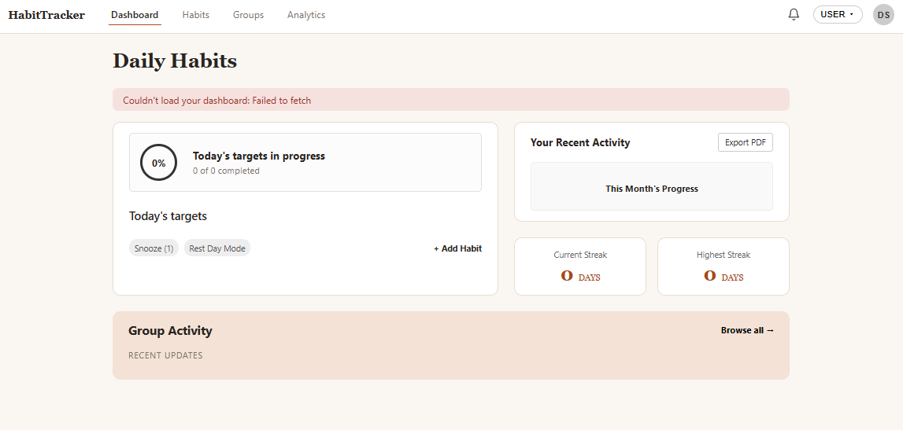
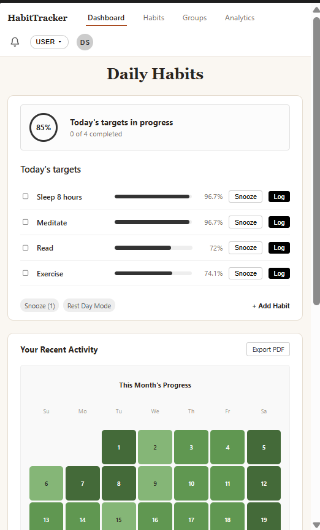
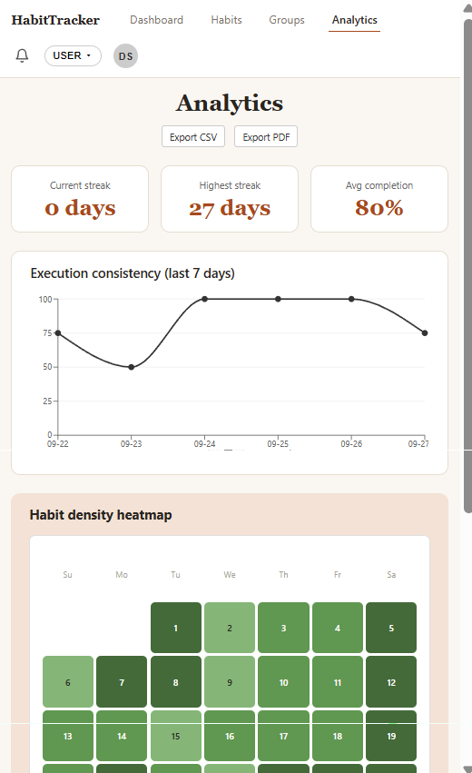
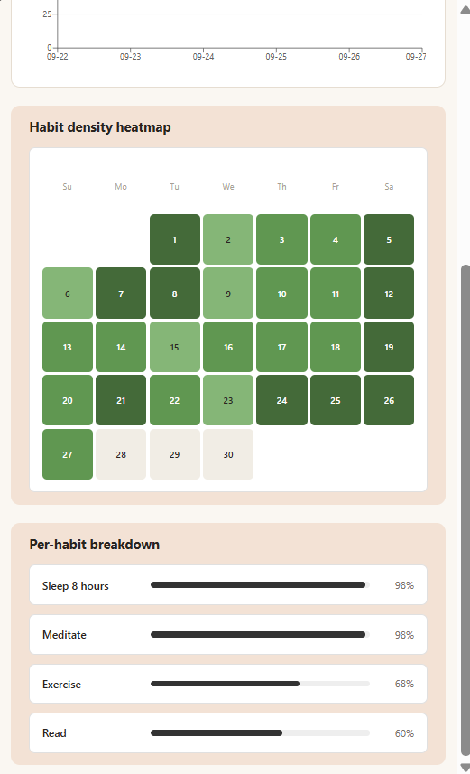

# Informal GUI Test Log — Dashboard & Analytics Pages

**Tester:** u24679039
**Date run:** 09/28/2026

## Setup 

1. Backend:
    ```
    cd backend
    npm install
    createdb habittracker          # or use an existing Postgres instance
    npx prisma migrate dev --name init
    npm start                      # listens on http://localhost:4000
    ```
2. Seed at least one test user (`user_id = 1`), 2–3 habits, and ~14 days of
   `habit_logs` with a mix of COMPLETED/REST_DAY/MISSED statuses so the
   dashboard has something to render. 

    ```
    npx prisma db seed
    ```

3. Frontend:
    ```
    cd frontend
    npm install
    npm run dev                    # opens http://localhost:5173
    ```

---

## Test 1 — Dashboard loads with asymmetric grid layout & habit progress

| Step | Action | Expected result |
|---|---|---|
| 1 | Open `http://localhost:5173` | Page loads with top nav showing "Dashboard", "Habits", "Groups", and "Analytics" tabs, with Dashboard active |
| 2 | Observe the main grid layout | The left-hand "Today's targets" card renders noticeably wider than the right-hand heatmap section for visual balance |
| 3 | Inspect the targets card contents | Shows an overall percentage ring at the top, followed by individual habit rows equipped with checkboxes, progress bars, completion rates, and "Snooze" / "Log" buttons |


**Result:** ▣ Pass ☐ Fail
**Discrepancies:** _none_

---

## Test 2 — Dashboard empty state (new user, no habits)

| Step | Action | Expected result |
|---|---|---|
| 1 | Point the frontend at a `userId` with zero habits (edit `DEMO_USER_ID` in `App.jsx` temporarily, or seed a fresh user) | Dashboard loads without error |
| 2 | Observe the "Today's targets" card | Shows the message "No active habits yet. Add one to get started." instead of an empty layout list |


**Result:** ▣ Pass ☐ Fail
**Discrepancies:** _none_

---

## Test 3 — Dashboard error state (backend unreachable)

| Step | Action | Expected result |
|---|---|---|
| 1 | Stop the backend (`Ctrl+C` in the backend terminal) | — |
| 2 | Reload `http://localhost:5173` | A red error banner appears at the top of the Dashboard reading "Couldn't load your dashboard: ..." rather than a blank page or stack trace |



**Result:** ▣ Pass ☐ Fail
**Discrepancies:** _none_

*(Restart the backend before continuing to the next tests.)*

---

## Test 4 — Analytics summary stats and chart render correctly

| Step | Action | Expected result |
|---|---|---|
| 1 | Click the "Analytics" tab | Page shows three summary stat cards: Current streak, Highest streak, and Avg completion |
| 2 | Observe the "Execution consistency" chart | A line chart renders showing a completion-rate data point per day over the active range |
| 3 | Hover over a point on the line chart | A tooltip appears displaying the specific date and completion percentage |


**Result:** ▣ Pass ☐ Fail
**Discrepancies:** _none_

---

## Test 5 — Analytics Heatmap and Per-Habit Breakdown

| Step | Action | Expected result |
|---|---|---|
| 1 | Scroll down on the Analytics tab | The monthly habit density heatmap renders correctly, showing shading per day based on completed habits |
| 2 | Observe the per-habit breakdown section | Active habits are listed with progress bars and completion status rates for the selected metrics period |


**Result:** ▣ Pass ☐ Fail
**Discrepancies:** _none_

---

## Test 6 — CSV export from Analytics

| Step | Action | Expected result |
|---|---|---|
| 1 | On the Analytics page, click "Export CSV" | Browser downloads `habittracker-analytics.csv` |
| 2 | Open the downloaded file | Contains a header row (`habitName,completionRate`) followed by one row per active habit matching the per-habit breakdown view |


**Result:** ▣ Pass ☐ Fail
**Discrepancies:** _none_

---

## Test 7 — PDF export utilities

| Step | Action | Expected result |
|---|---|---|
| 1 | Click "Export PDF" from either the Analytics page or the Dashboard's heatmap card header | Browser downloads the generated PDF report (`habittracker-analytics.pdf`) |
| 2 | Open the PDF file | Displays the proper header, user scope, month context, summary analytics, and per-habit breakdown list |


**Result:** ▣ Pass ☐ Fail
**Discrepancies:** _none_

---

## Test 8 — Dashboard page responsiveness

| Step | Action | Expected result |
|---|---|---|
| 1 | Open the Dashboard view and open browser developer tools | Enable mobile device emulation or narrow the viewport width below 900px |
| 2 | Observe the layout shift | The asymmetric grid layout cleanly collapses into a single-column stacked view, preserving readability and touch targets |




**Result:** ▣ Pass ☐ Fail
**Discrepancies:** _none_

---

## Test 9 — Analytics page responsiveness

| Step | Action | Expected result |
|---|---|---|
| 1 | Navigate to the Analytics tab and narrow the browser viewport width below mobile breakpoints | — |
| 2 | Inspect summary cards, charts, and breakdown elements | Stat cards, charts, and breakdown listings scale or wrap appropriately without horizontal clipping or overflow issues |




**Result:** ▣ Pass ☐ Fail
**Discrepancies:** _none_

---

## Summary

| Test | Result |
|---|---|
| 1. Dashboard loads with wider targets card & progress bars | ▣ Pass ☐ Fail |
| 2. Dashboard empty state | ▣ Pass ☐ Fail |
| 3. Dashboard error state | ▣ Pass ☐ Fail |
| 4. Analytics stats + chart | ▣ Pass ☐ Fail |
| 5. Analytics heatmap and per-habit breakdown | ▣ Pass ☐ Fail |
| 6. CSV export | ▣ Pass ☐ Fail |
| 7. PDF export | ▣ Pass ☐ Fail |
| 8. Dashboard page responsiveness | ▣ Pass ☐ Fail |
| 9. Analytics page responsiveness | ▣ Pass ☐ Fail |

**Overall:** ▣ All tests passed ☐ Issues found