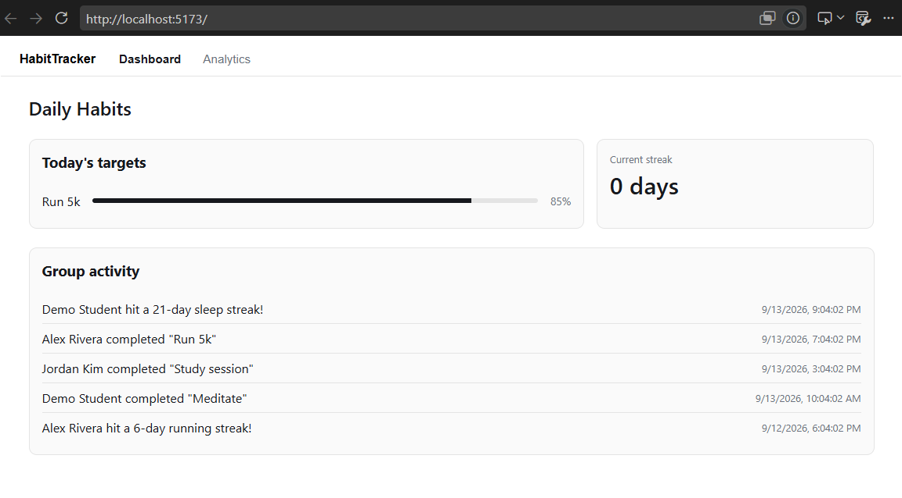
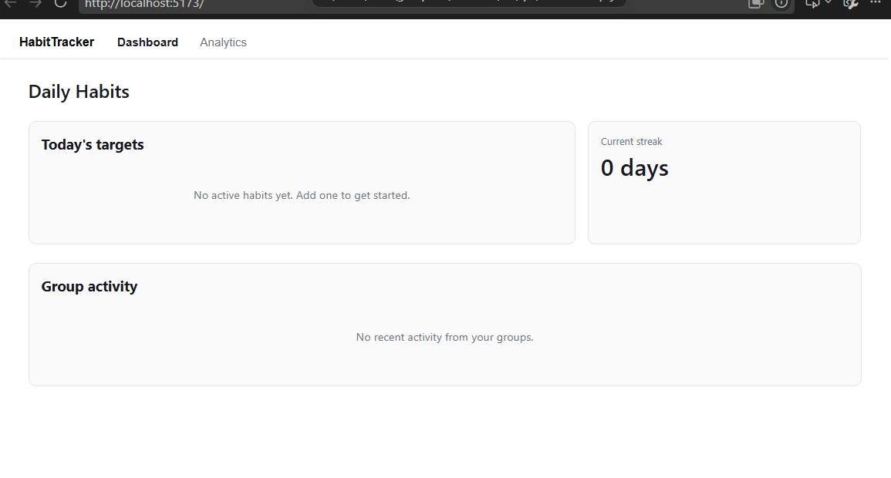
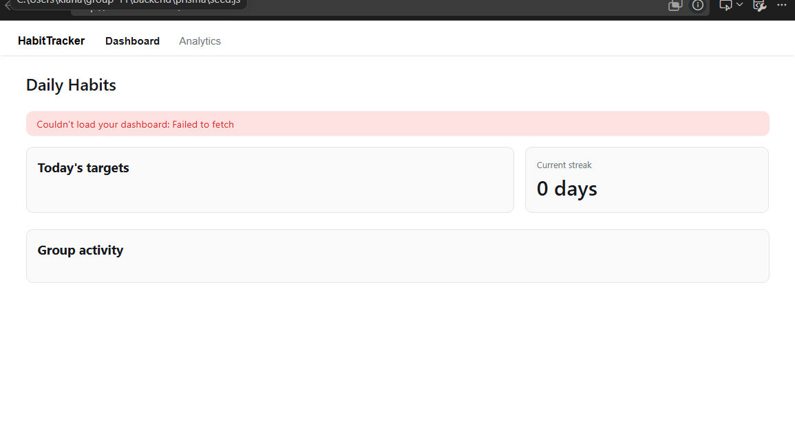
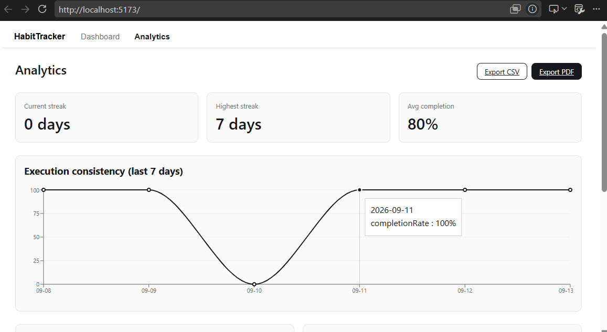
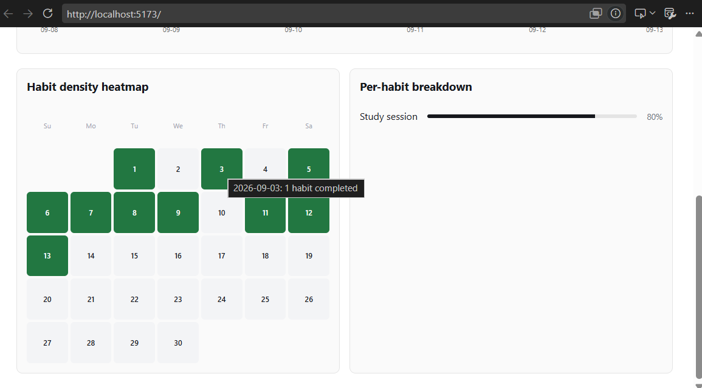
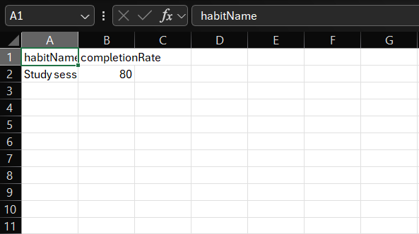
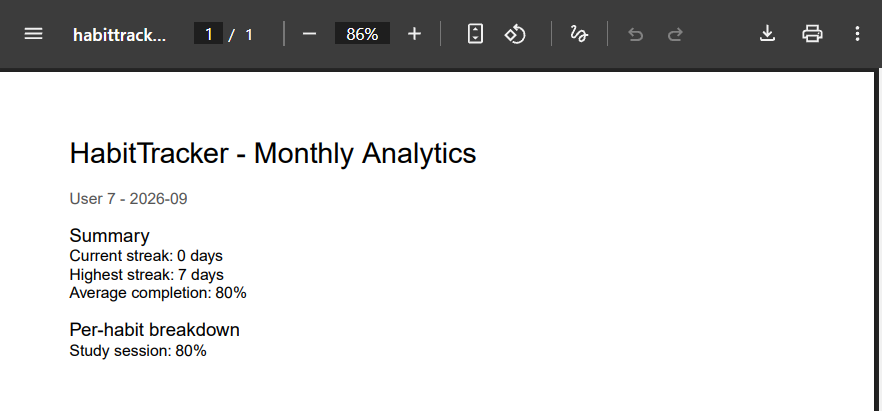

# Informal GUI Test Log — Dashboard & Analytics Pages

**Tester:** u24679039
**Date run:** 09/13/2026

## Setup 

1. Backend:
   ```
   cd backend
   npm install
   createdb habittracker          # or use an existing Postgres instance
   npx prisma migrate dev --name init
   npm start                    # listens on http://localhost:4000
   ```
2. Seed at least one test user (`user_id = 1`), 2–3 habits, and ~14 days of
   `habit_logs` with a mix of COMPLETED/REST_DAY/MISSED statuses so the
   dashboard has something to render. 

   ```
   npx prisma db seed
   ```

3. Frontend:
   ```
   cd frontend
   npm install
   npm run dev                  # opens http://localhost:5173
   ```

---

## Test 1 — Dashboard loads today's habits with progress bars

| Step | Action | Expected result |
|---|---|---|
| 1 | Open `http://localhost:5173` | Page loads with a top nav showing "Dashboard" and "Analytics" tabs, Dashboard tab active |
| 2 | Observe the "Today's targets" card | Each seeded habit appears as a row with its name, a progress bar, and a completion percentage |
| 3 | Observe the "Current streak" card | Shows the highest current streak across the user's habits, in days |



**Result:** ▣ Pass ☐ Fail
**Discrepancies:** _none_

---

## Test 2 — Dashboard empty state (new user, no habits)

| Step | Action | Expected result |
|---|---|---|
| 1 | Point the frontend at a `userId` with zero habits (edit `DEMO_USER_ID` in `App.jsx` temporarily, or seed a fresh user) | Dashboard loads without error |
| 2 | Observe the "Today's targets" card | Shows the message "No active habits yet. Add one to get started." instead of an empty table |



**Result:** ▣ Pass ☐ Fail
**Discrepancies:** _none_

---

## Test 3 — Dashboard error state (backend unreachable)

| Step | Action | Expected result |
|---|---|---|
| 1 | Stop the backend (`Ctrl+C` in the backend terminal) | — |
| 2 | Reload `http://localhost:5173` | A red error banner appears at the top of the Dashboard reading "Couldn't load your dashboard: ..." rather than a blank page or a raw stack trace |



**Result:** ▣ Pass ☐ Fail
**Discrepancies:** _none_

*(Restart the backend before continuing to the next tests.)*

---

## Test 4 — Analytics summary stats and chart render correctly

| Step | Action | Expected result |
|---|---|---|
| 1 | Click the "Analytics" tab | Page shows three stat cards: Current streak, Highest streak, Avg completion |
| 2 | Observe the "Execution consistency" chart | A line chart renders showing a completion-rate point per day over the last 7 days |
| 3 | Hover over a point on the line chart | A tooltip appears showing the date and completion percentage |



**Result:** ▣ Pass ☐ Fail
**Discrepancies:** _none_

---

## Test 5 — Analytics heatmap and per-habit breakdown

| Step | Action | Expected result |
|---|---|---|
| 1 | On the Analytics page, observe the "Habit density heatmap" | A calendar grid for the current month renders, with completed days shaded green (darker = more habits completed that day) |
| 2 | Hover a shaded day | Tooltip shows the date and the number of habits completed |
| 3 | Observe the "Per-habit breakdown" card | Habits are listed with progress bars, sorted from highest to lowest completion rate |



**Result:** ▣ Pass ☐ Fail
**Discrepancies:** _none_

---

## Test 6 — CSV export

| Step | Action | Expected result |
|---|---|---|
| 1 | On the Analytics page, click "Export CSV" | Browser downloads `habittracker-analytics.csv` |
| 2 | Open the downloaded file | Contains a header row (`habitName,completionRate`) followed by one row per active habit, matching what's shown in the Per-habit breakdown card |



**Result:** ▣ Pass ☐ Fail
**Discrepancies:** _none_

---

## Test 7 — PDF export

| Step | Action | Expected result |
|---|---|---|
| 1 | On the Analytics page, click "Export PDF" | Browser downloads `habittracker-analytics.pdf` |
| 2 | Open the PDF | Shows a "HabitTracker - Monthly Analytics" header, the user/month, the three summary stats, and a per-habit breakdown list |



**Result:** ▣ Pass ☐ Fail
**Discrepancies:** _none_

---

## Summary

| Test | Result |
|---|---|
| 1. Dashboard loads with progress bars | ▣ Pass ☐ Fail |
| 2. Dashboard empty state | ▣ Pass ☐ Fail |
| 3. Dashboard error state | ▣ Pass ☐ Fail |
| 4. Analytics stats + chart | ▣ Pass ☐ Fail |
| 5. Analytics heatmap + breakdown | ▣ Pass ☐ Fail |
| 6. CSV export | ▣ Pass ☐ Fail |
| 7. PDF export | ▣ Pass ☐ Fail |

**Overall:** ▣ All tests passed ☐ Issues found 
