# Informal GUI Testing

This document contains the manual GUI tests for the Micro-Group and Invite System.

---

## GUI-01: Create Group

**Purpose:**  
Check that a user can create a group and receive an invitation code.

**Steps:**
1. Open the application as User 1.
2. Click **Create Group**.
3. Enter valid group details.
4. Click **Create Group**.

**Expected Result:**  
The group is created and an invitation code is displayed.

**Actual Result:**  
The group was created successfully and an invitation code was displayed.

**Result:** PASS

**Screenshots:**

Input:

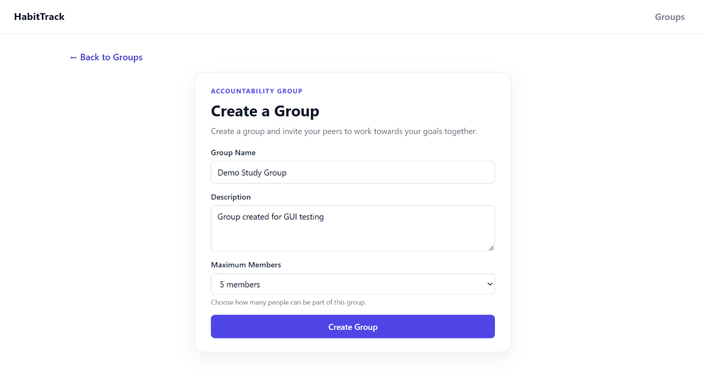

Result:

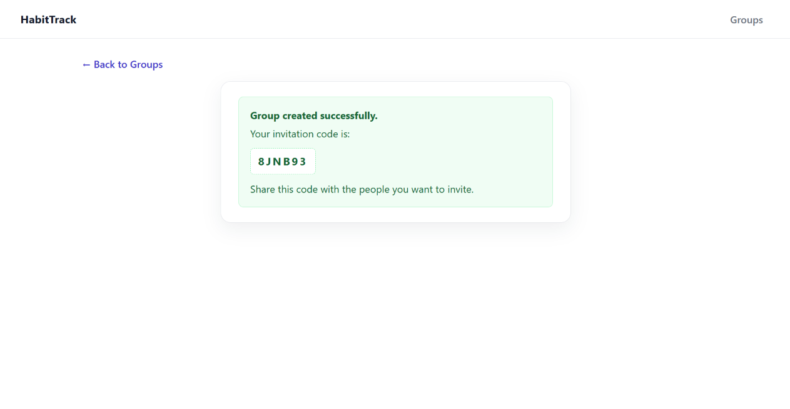

---

## GUI-02: Join Group

**Purpose:**  
Check that a user can join a group using a valid invitation code.

**Steps:**
1. Open the application as User 2.
2. Click **Join with code**.
3. Enter a valid invitation code.
4. Click **Join Group**.

**Expected Result:**  
The user joins the group successfully and the group appears in their group list.

**Actual Result:**  
The user joined successfully and the group appeared in their group list.

**Result:** PASS

**Screenshots:**

Input:

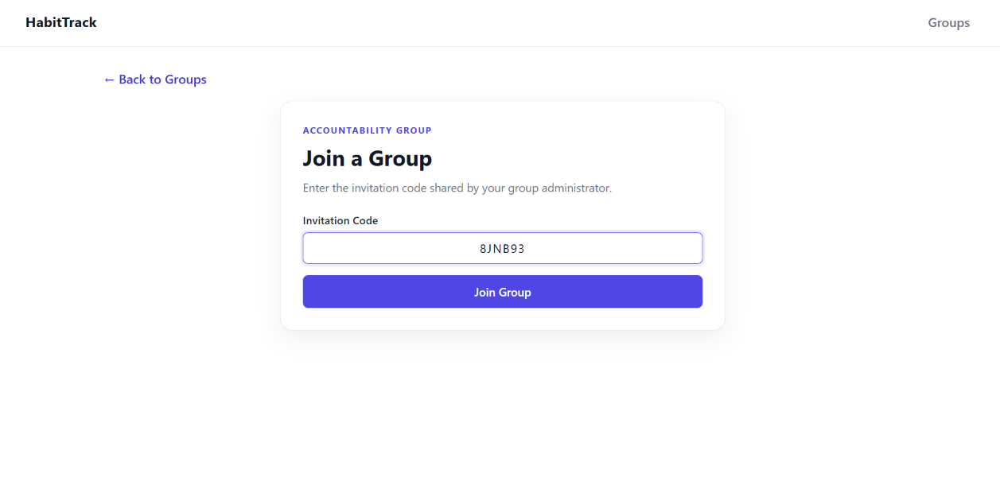

Success:

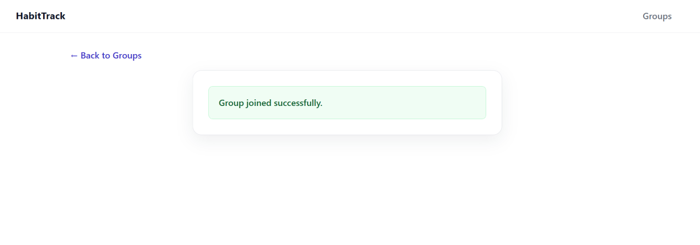

Result:

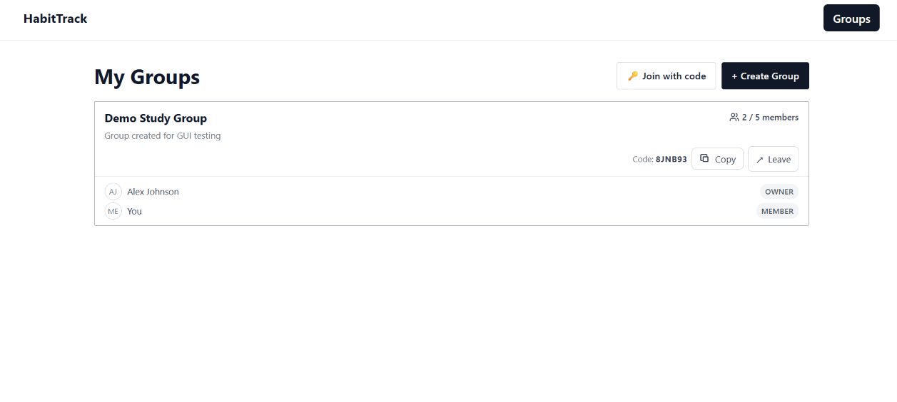

---

## GUI-03: Edit Group

**Purpose:**  
Check that a group owner can edit the group settings.

**Steps:**
1. Open the group as User 1.
2. Click **Manage Group**.
3. Click **Edit Group**.
4. Change the group details.
5. Click **Save Changes**.

**Expected Result:**  
The changes are saved and the updated group details are displayed.

**Actual Result:**  
The group settings were updated successfully and the new details were displayed.

**Result:** PASS

**Screenshots:**

Input:

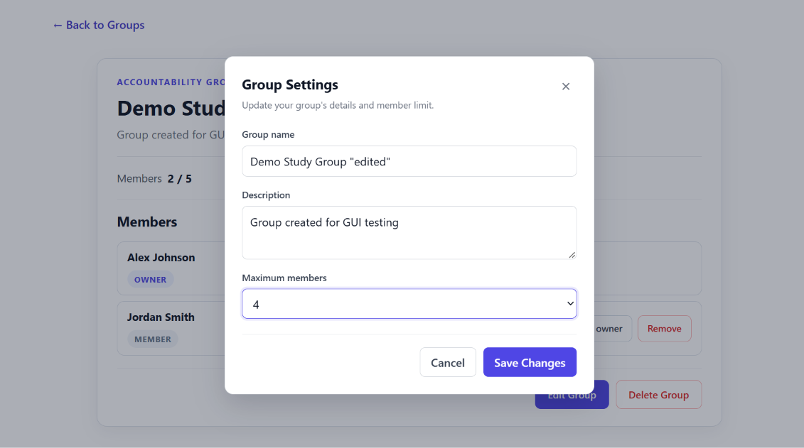

Result:

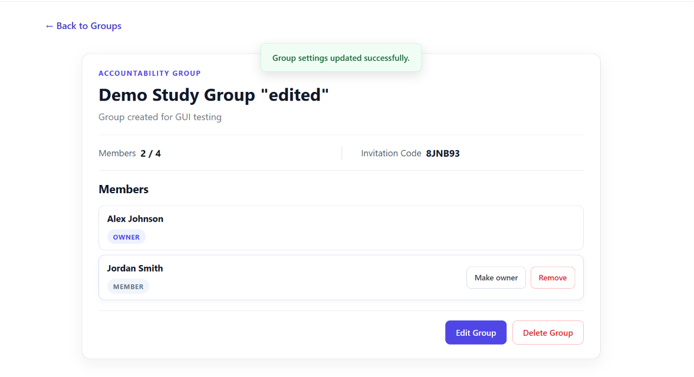

---

## GUI-04: Change Member Role

**Purpose:**  
Check that a group owner can change another member's role.

**Steps:**
1. Open **Manage Group** as User 1.
2. Find User 2 in the member list.
3. Click **Make owner**.

**Expected Result:**  
User 2's role changes from MEMBER to OWNER.

**Actual Result:**  
The role was updated successfully and User 2 was displayed as an OWNER.

**Result:** PASS

**Screenshots:**

Before:

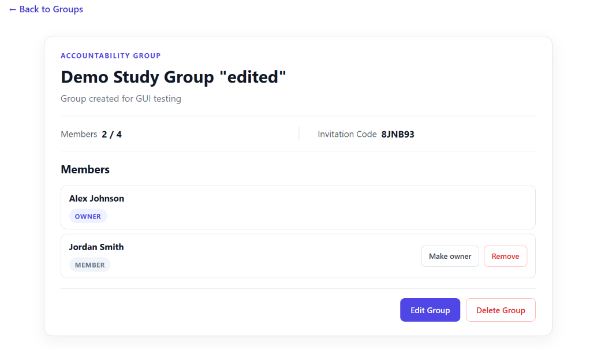

Result:

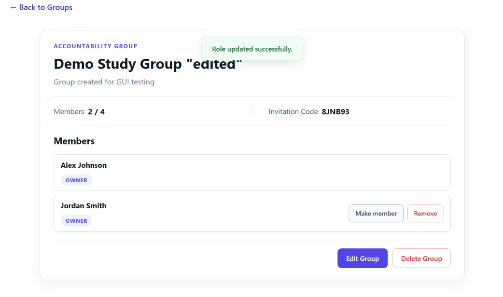

---

## GUI-05: Remove Member

**Purpose:**  
Check that a group owner can remove another member from the group.

**Steps:**
1. Open **Manage Group** as User 1.
2. Find User 2 in the member list.
3. Click **Remove**.
4. Confirm the removal.

**Expected Result:**  
User 2 is removed and no longer appears in the member list.

**Actual Result:**  
User 2 was removed successfully and disappeared from the member list.

**Result:** PASS

**Screenshots:**

Before:

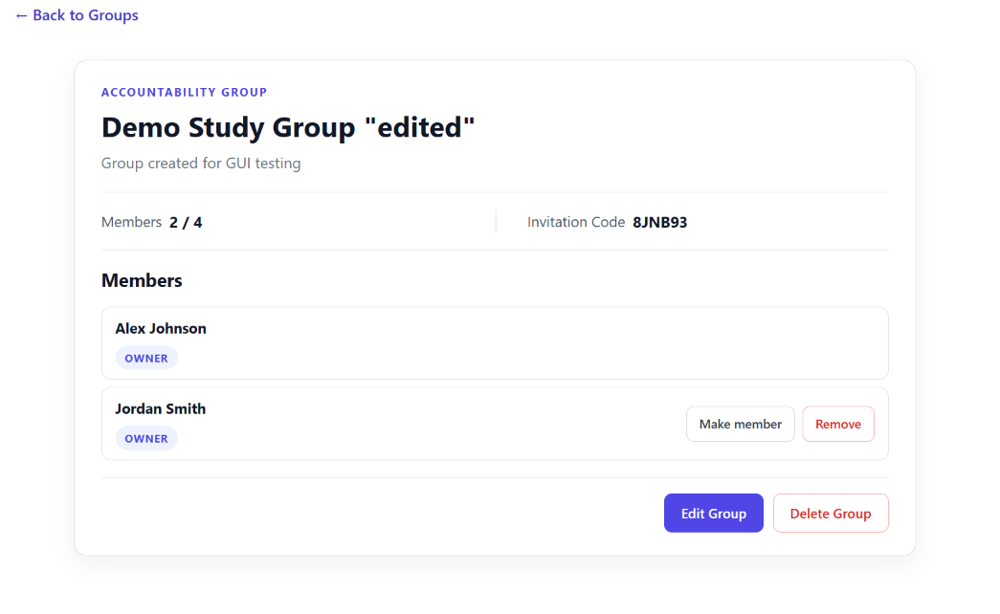

Confirmation:

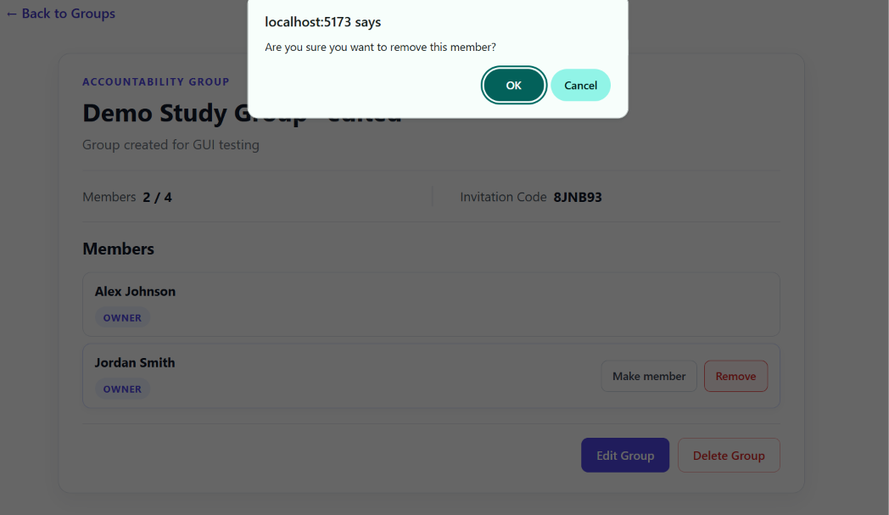

Result:

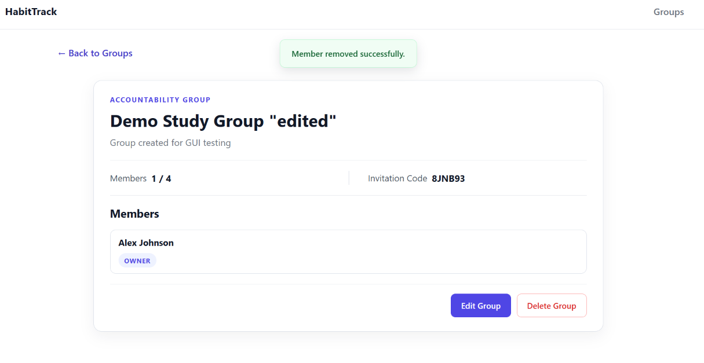

---

## GUI-06: Leave Group

**Purpose:**  
Check that a member can leave a group.

**Steps:**
1. Open the application as User 2.
2. Find the group in **My Groups**.
3. Click **Leave**.
4. Confirm leaving the group.

**Expected Result:**  
User 2 leaves the group and the group is removed from their group list.

**Actual Result:**  
User 2 left successfully and the group no longer appeared in their group list.

**Result:** PASS

**Screenshots:**

Before:

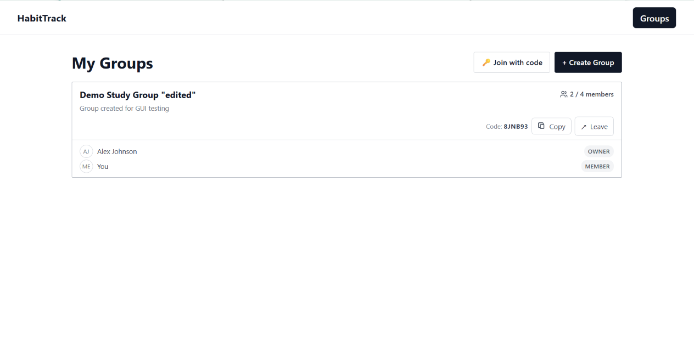

Confirmation:

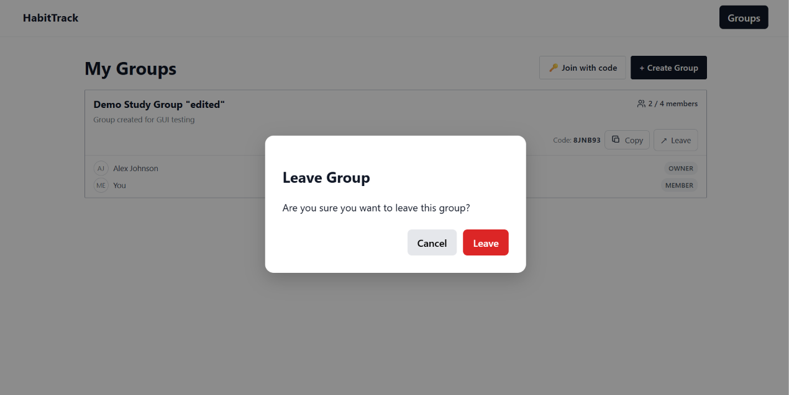

Result:

---

## GUI-07: Delete Group

**Purpose:**  
Check that a group owner can delete a group.

**Steps:**
1. Open **Manage Group** as User 1.
2. Click **Delete Group**.
3. Confirm the deletion.

**Expected Result:**  
The group is deleted and no longer appears in the owner's group list.

**Actual Result:**  
The group was deleted successfully and no longer appeared in the group list.

**Result:** PASS

**Screenshots:**

Before:

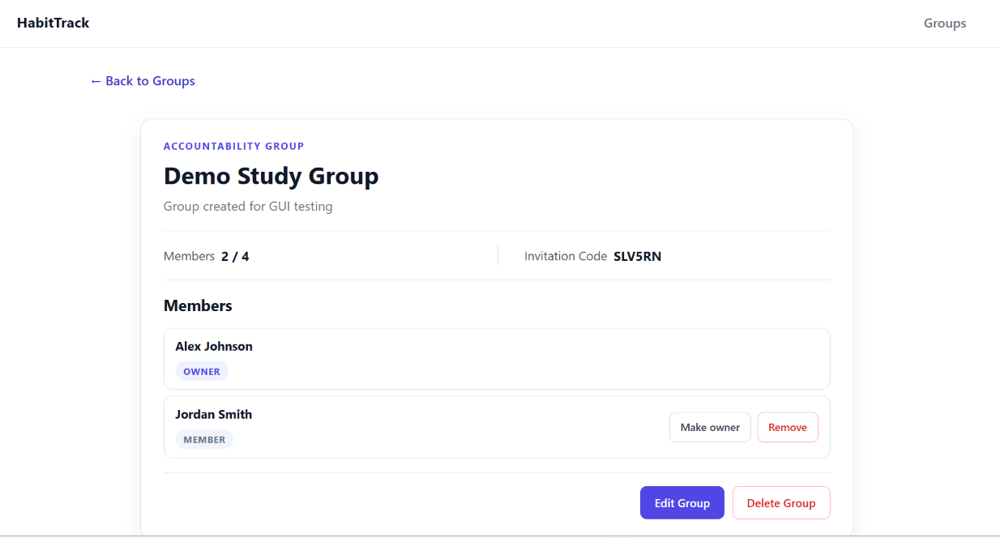

Confirmation:

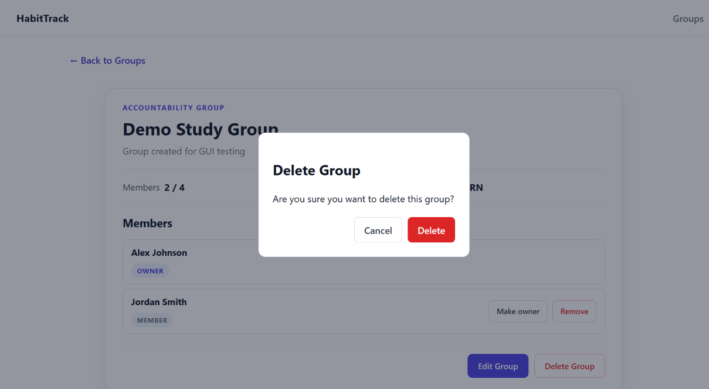

Result:

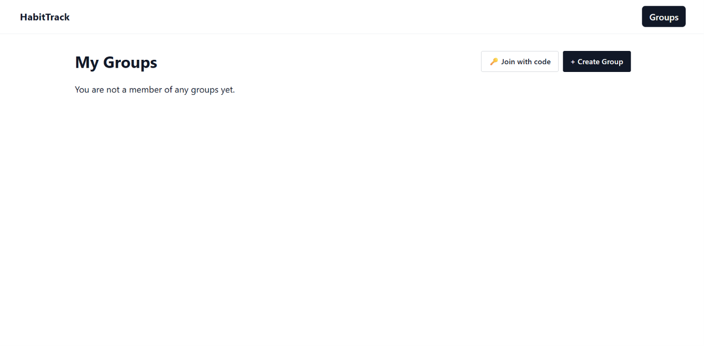