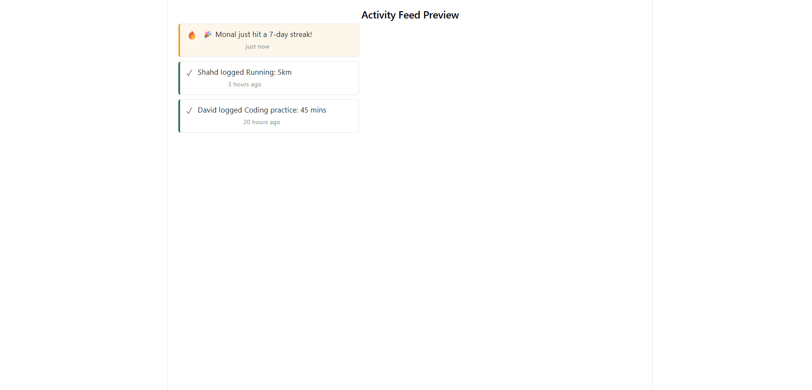
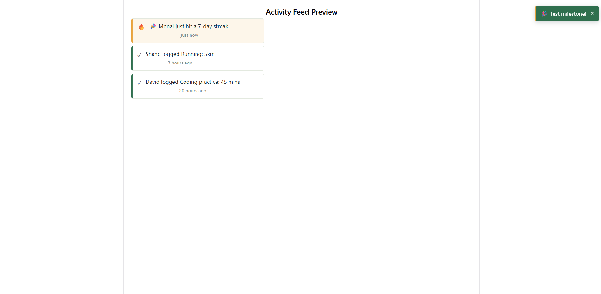

# Informal GUI Test Log — Activity Feed & Milestone Toast (EH-59, EH-60)

This document lets anyone repeat these tests themselves and confirm they get
the same result. Both components were tested using a temporary local preview
(Vite + React), with mock data matching the real shape produced by
`buildGroupFeed` (EH-34).

## Test 1 — Activity Feed renders correctly

**Steps to reproduce:**
1. Run the preview app (`npm run dev` inside the `preview` folder) and open
   the printed local address in a browser.
2. Observe the rendered list under "Activity Feed Preview."

**Expected result:**
- Three entries appear, newest first.
- The milestone entry ("Monal just hit a 7-day streak!") appears at the top,
  with an amber left-edge stripe and a 🔥 icon.
- The two habit-completion entries appear below it, each with a green
  left-edge stripe and a ✓ icon.
- Each entry shows a correctly formatted relative time ("just now",
  "3 hours ago", "20 hours ago").

**Actual result:** ✅ Matches expected exactly.

**Screenshot:**
__

---

## Test 2 — Milestone Toast appears and auto-dismisses

**Steps to reproduce:**
1. Refresh the preview page in the browser.
2. Immediately look at the top-right corner of the screen.
3. Wait 5+ seconds without interacting further.

**Expected result:**
- A green toast banner appears in the top-right corner within the first
  second, showing the milestone message with an amber left-edge accent and
  a close (×) button.
- After 5 seconds, the toast disappears automatically without any user
  action.
- If clicked before 5 seconds, the close button dismisses it immediately.

**Actual result:** ✅ Matches expected exactly.

**Screenshot:**
__

---

## Notes

- Both components were tested against mock data shaped identically to what
  `buildGroupFeed` (EH-34) actually returns, so no changes should be needed
  when this is later wired up to the real feed data.
- The underlying display logic (`formatRelativeTime`,
  `getLatestMilestoneMessage`) is additionally covered by formal automated
  tests in `frontend/test_feedDisplayHelpers.js` (8/8 passing).